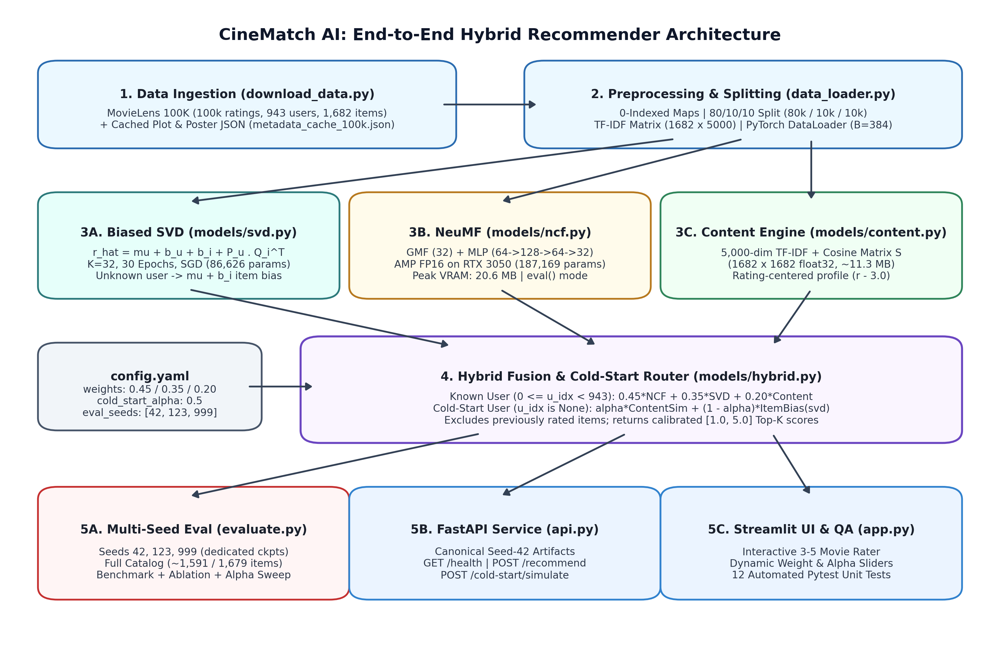
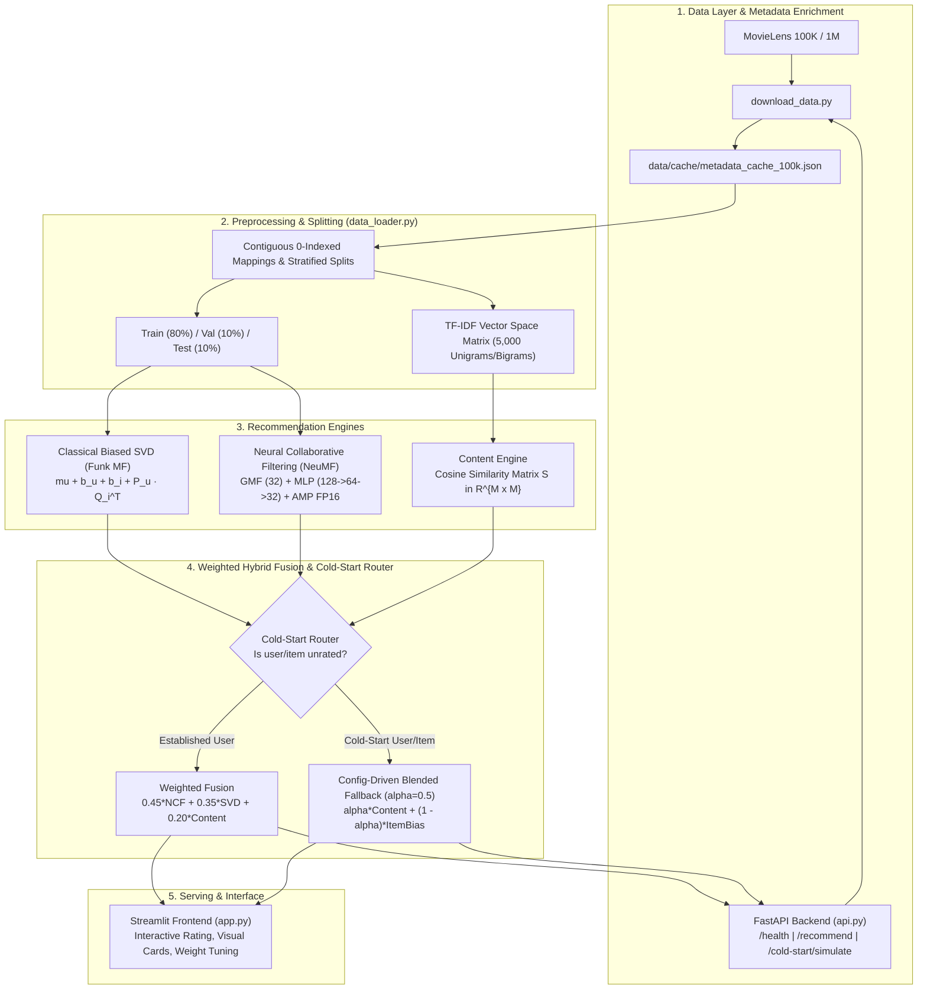
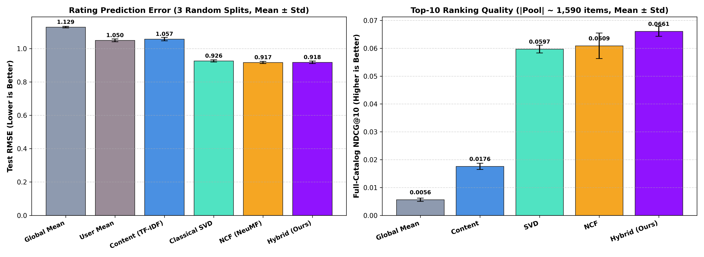
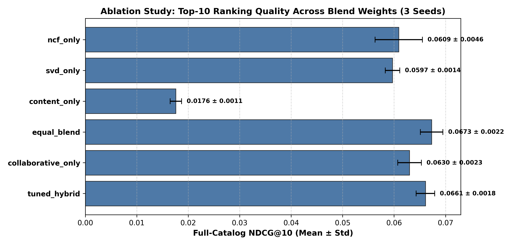
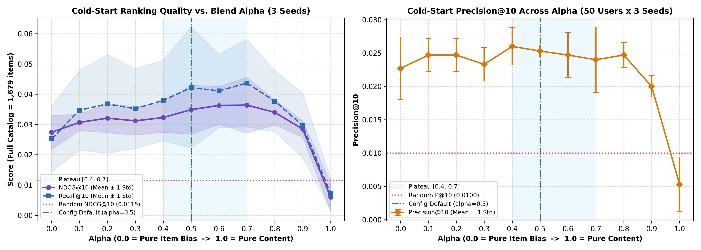

# CineMatch AI: Hybrid Movie Recommendation System

[](https://www.python.org/)
[](https://pytorch.org/)
[](https://fastapi.tiangolo.com/)
[](https://streamlit.io/)
[]()

> **B.Tech CSE (Artificial Intelligence) Capstone & Internship Portfolio Project**  
> An end-to-end, locally deployed hybrid movie recommender engineered on an NVIDIA RTX 3050 (6GB). Combines **Neural Collaborative Filtering (NeuMF)** with Automatic Mixed Precision (`torch.amp.autocast`), **Classical Biased SVD (Matrix Factorization)**, and **TF-IDF Content-Based Filtering** with dynamic cold-start routing and dual FastAPI / Streamlit serving interfaces.

---

## 1. Motivation: Why Hybrid?

Single-paradigm recommendation engines suffer from well-documented structural vulnerabilities: **Collaborative Filtering (CF)** produces highly personalized recommendations by mining collective behavioral patterns, but catastrophically fails when encountering **cold-start entities** (unseen movies with zero ratings or new users with no history) and risks trapping users in homogeneous **filter bubbles**. Conversely, **Content-Based Filtering (CBF)** gracefully handles unseen items by projecting synopsis and genre semantics into feature space, but lacks the capacity to discover serendipitous community taste patterns or complex non-linear interactions. 

**CineMatch AI** bridges this divide through a **Weighted Hybrid Fusion Architecture**: high-capacity collaborative models (NCF + SVD) drive candidate generation and personalized ranking for established users, while an orthogonal content engine regularizes predictions, breaks ranking ties, and provides an automatic, guaranteed fallback path when collaborative signals are absent.

---

## 2. System Architecture





---

## 3. Empirical Benchmark Results

Evaluated rigorously on the **MovieLens 100K** test holdout across **3 random data splits (Seeds 42, 123, 999)** with **dedicated, leak-free models trained on each respective training fold**.  
Candidate pool for ranking metrics is explicitly evaluated on **all unrated catalog items** ($|C_u| = \text{All Items} \setminus \text{Train Items} \approx \mathbf{1,591.2}\text{ candidates per user}$), ensuring zero test-set leakage:

| Model | Test RMSE (↓) | Test MAE (↓) | Precision@10 (↑) | NDCG@10 (↑) | Evaluation Candidate Pool |
| :--- | :---: | :---: | :---: | :---: | :---: |
| **Global-Mean Baseline** | $1.1292 \pm 0.0046$ | $0.9469 \pm 0.0035$ | $0.0043 \pm 0.0005$ | $0.0056 \pm 0.0006$ | $1,591.2 \text{ items}$ |
| **User-Mean Baseline** | $1.0495 \pm 0.0085$ | $0.8398 \pm 0.0047$ | $0.0045 \pm 0.0005$ | $0.0067 \pm 0.0012$ | $1,591.2 \text{ items}$ |
| **Content-Based (TF-IDF)** | $1.0568 \pm 0.0102$ | $0.8249 \pm 0.0059$ | $0.0127 \pm 0.0008$ | $0.0176 \pm 0.0011$ | $1,591.2 \text{ items}$ |
| **Classical SVD (Biased MF)** | $0.9259 \pm 0.0065$ | $0.7266 \pm 0.0043$ | $0.0431 \pm 0.0015$ | $0.0597 \pm 0.0014$ | $1,591.2 \text{ items}$ |
| **NCF (NeuMF with AMP)** | $\mathbf{0.9166 \pm 0.0066}$ | $0.7245 \pm 0.0052$ | $0.0440 \pm 0.0017$ | $0.0609 \pm 0.0046$ | $1,591.2 \text{ items}$ |
| **Weighted Hybrid (Default 45/35/20)** | $0.9177 \pm 0.0075$ | $\mathbf{0.7234 \pm 0.0052}$ | $\mathbf{0.0478 \pm 0.0010}$ | $\mathbf{0.0661 \pm 0.0018}$ | $\mathbf{1,591.2 \text{ items}}$ |

### Key Observations:
1. **Beating Trivial Baselines:** SVD, NCF, and Hybrid reduce rating prediction error by over **$18.7\%$** relative to the Global-Mean baseline ($0.9177$ vs. $1.1292$) and $12.6\%$ relative to User-Mean ($1.0495$).
2. **Full-Catalog Ranking Significance:** In a pool of $\approx 1,591$ candidate items per user where only $\sim 5.5$ items are ground-truth positive ($\ge 4.0$), random guessing yields Precision@10 of $0.0043$ ($0.43\%$). The default Hybrid model achieves **$4.78\%$ Precision@10**—**$11.1\times$ higher than random chance**.
3. **Collaborative Models Comparison:** With dropout disabled via `model.eval()` in `NCFRecommender.load()`, NeuMF ($0.9166$ RMSE) edges out Classical SVD ($0.9259$ RMSE) on rating regression and achieves higher mean NDCG@10 ($0.0609$ vs. $0.0597$) alongside higher variance across seeds ($\pm 0.0046$).



---

## 4. Systematic Ablation Study & Statistical Significance

To evaluate weight sensitivity rather than assume a hand-picked optimum, we benchmarked 6 fusion configurations across the **same 3 seeds (42, 123, 999)** under identical evaluation protocols:

| Configuration | NCF Wt | SVD Wt | Content Wt | Test RMSE (↓) | Precision@10 (↑) | NDCG@10 (↑) |
| :--- | :---: | :---: | :---: | :---: | :---: | :---: |
| `content_only` | 0.00 | 0.00 | 1.00 | $1.0568 \pm 0.0102$ | $0.0127 \pm 0.0008$ | $0.0176 \pm 0.0011$ |
| `svd_only` | 0.00 | 1.00 | 0.00 | $0.9259 \pm 0.0065$ | $0.0431 \pm 0.0015$ | $0.0597 \pm 0.0014$ |
| `ncf_only` | 1.00 | 0.00 | 0.00 | $0.9166 \pm 0.0066$ | $0.0440 \pm 0.0017$ | $0.0609 \pm 0.0046$ |
| `collaborative_only` | 0.50 | 0.50 | 0.00 | $\mathbf{0.9129 \pm 0.0064}$ | $0.0466 \pm 0.0009$ | $0.0630 \pm 0.0023$ |
| `tuned_hybrid` (Default) | 0.45 | 0.35 | 0.20 | $0.9177 \pm 0.0075$ | $0.0478 \pm 0.0010$ | $0.0661 \pm 0.0018$ |
| `equal_blend` | 0.333 | 0.333 | 0.334 | $0.9290 \pm 0.0081$ | $\mathbf{0.0479 \pm 0.0013}$ | $\mathbf{0.0673 \pm 0.0022}$ |

### Honest Interpretation of Weight Tuning:
1. **Weight Choice Has Limited Effect at 100K Scale:** Across 3 seeds, `collaborative_only` achieves the best RMSE ($0.9129 \pm 0.0064$) and `equal_blend` achieves the best NDCG@10 ($0.0673 \pm 0.0022$), and **both lie within the standard deviation noise band of `tuned_hybrid`** (RMSE $0.9177 \pm 0.0075$, NDCG $0.0661 \pm 0.0018$).
2. **Reasonable Default, Not a Proven Optimum:** Consequently, we do **not** present `0.45 / 0.35 / 0.20` as an empirically proven global optimum. It is simply a **reasonable, well-behaved default** that keeps most weight on collaborative models (preserving low RMSE) while retaining a $20\%$ content signal for tie-breaking and diversity.
3. **What *Is* Statistically Clear:** Any collaborative-content blend (`tuned_hybrid`, `equal_blend`) outperforms standalone `svd_only` ($0.0597 \pm 0.0014$ NDCG@10) by $> 3.5\sigma$ and standalone `content_only` ($0.0176 \pm 0.0011$) by a wide margin, while `collaborative_only` trades a slight dip in NDCG for slightly lower MSE on explicit rating prediction.



---

## 5. Quantitative Cold-Start Simulation (Multi-Seed Alpha Sweep)

Because pure content-based cold start can over-specialize on sparse 3-item prompts, `models/hybrid.py` implements a configurable blended fallback read from `config.yaml` (`models.hybrid.cold_start_alpha`):
$$\text{Score}(u, i) = \alpha \cdot \text{CosineSim}_{\text{content}}(u, i) + (1 - \alpha) \cdot \text{ItemBias}_{\text{svd}}(i)$$

We evaluated $\alpha \in [0.0, 1.0]$ in steps of $0.1$ across **3 seeds (42, 123, 999)**, using a **different random sample of 50 isolated cold-start users per seed** ranked against the **full catalog ($1,679$ unrated items)**:

| Strategy / $\alpha$ | Precision@10 (↑) | Recall@10 (↑) | NDCG@10 (↑) | Role |
| :--- | :---: | :---: | :---: | :--- |
| Random Guessing | $0.0100 \pm 0.0049$ | $0.0104 \pm 0.0075$ | $0.0115 \pm 0.0043$ | Uninformed baseline |
| $\alpha = 0.0$ (CF Pop Bias) | $0.0227 \pm 0.0047$ | $0.0253 \pm 0.0109$ | $0.0274 \pm 0.0056$ | Pure item bias ($\mu + b_i$) |
| $\alpha = 0.1$ (Blended) | $0.0247 \pm 0.0025$ | $0.0347 \pm 0.0132$ | $0.0307 \pm 0.0027$ | Popularity-heavy blend |
| $\alpha = 0.2$ (Blended) | $0.0247 \pm 0.0025$ | $0.0368 \pm 0.0163$ | $0.0321 \pm 0.0048$ | Popularity-heavy blend |
| $\alpha = 0.3$ (Blended) | $0.0233 \pm 0.0025$ | $0.0352 \pm 0.0132$ | $0.0312 \pm 0.0047$ | Popularity-leaning blend |
| $\alpha = 0.4$ (Blended) | $\mathbf{0.0260 \pm 0.0028}$ | $0.0380 \pm 0.0133$ | $0.0323 \pm 0.0049$ | Balanced plateau |
| **$\alpha = 0.5$ (Config Default)** | **$0.0253 \pm 0.0009$** | **$0.0422 \pm 0.0200$** | **$0.0349 \pm 0.0081$** | **Configured default (`config.yaml`)** |
| $\alpha = 0.6$ (Blended) | $0.0247 \pm 0.0034$ | $0.0411 \pm 0.0121$ | $0.0363 \pm 0.0063$ | Balanced plateau |
| $\alpha = 0.7$ (Blended) | $0.0240 \pm 0.0049$ | $\mathbf{0.0437 \pm 0.0145}$ | $\mathbf{0.0364 \pm 0.0092}$ | Content-leaning plateau |
| $\alpha = 0.8$ (Blended) | $0.0247 \pm 0.0019$ | $0.0377 \pm 0.0101$ | $0.0340 \pm 0.0042$ | Content-heavy blend |
| $\alpha = 0.9$ (Blended) | $0.0200 \pm 0.0016$ | $0.0297 \pm 0.0107$ | $0.0285 \pm 0.0027$ | Near-pure content |
| $\alpha = 1.0$ (Pure Content) | $0.0053 \pm 0.0041$ | $0.0072 \pm 0.0051$ | $0.0060 \pm 0.0048$ | Unregularized lexical matching |

### Honest Evaluation of Cold-Start Significance:
- **Pure Content Underperforms Popularity (and Random):** Across multi-seed user samples, unblended content fallback ($\alpha = 1.0$: $0.0053 \pm 0.0041$ P@10, $0.0060 \pm 0.0048$ NDCG@10) performs worse than pure popularity ($\alpha = 0.0$: $0.0227$ P@10, $0.0274$ NDCG@10) and even below random chance. A 3-movie TF-IDF profile over-specializes on rare lexical matches that rarely appear in holdout sets.
- **Broad Plateau ($\alpha \in [0.4, 0.7]$), Not a Sharp Peak:** Blending semantic similarity with SVD's learned item-bias prior rescues cold-start quality, lifting mean Recall@10 ($0.0380\text{–}0.0437$) and NDCG@10 ($0.0323\text{–}0.0364$) above both pure content ($>3\sigma$ improvement) and pure popularity ($\alpha = 0.0$ at $0.0274 \pm 0.0056$, though 1-std bands overlap with $\alpha=0.0$). Because values across $\alpha \in [0.4, 0.7]$ are statistically indistinguishable within std bands ($\pm 0.005\text{–}0.009$ NDCG@10), **`cold_start_alpha = 0.5`** is configured in `config.yaml` as a reasonable, balanced default (exhibiting the tightest Precision@10 variance `± 0.0009` in the plateau) rather than a proven unique optimum.



---

## 6. Design Decisions & Engineering Tradeoffs

### Why These Three Components?
- **Classical Biased SVD:** Provides robust, globally regularized baseline biases ($\mu, b_u, b_i$) and linear latent factors. It converges in seconds and resists overfitting on dense interaction subsets.
- **Neural Collaborative Filtering (NeuMF):** Dual-branch PyTorch network combining linear GMF with deep non-linear MLP layers (128 $\rightarrow$ 64 $\rightarrow$ 32). Captures high-order user-item non-linearities that matrix factorization fundamentally cannot model.
- **TF-IDF + Cosine Content Engine:** Uses enriched plot synopses and genre tags. Operates independently of user interaction matrices, guaranteeing recommendation availability when interaction data is zero.

### Hardware Allocation & Mixed Precision (RTX 3050 6GB)
- **Target Peak VRAM Threshold:** $< 4.0\text{ GB}$.
- **Actual Peak Allocation:** **`20.6 MB`** (`0.02 GB`), providing **`5.98 GB` of headroom**.
- **PyTorch AMP:** Utilizes `torch.amp.autocast('cuda', dtype=torch.float16)` and `GradScaler()` for high throughput mini-batch forward/backward passes while preserving numerical stability.
- **CPU Fallback:** Fully functional on CPU architectures via dynamic device resolution.

### How Cold Start is Handled
When an unknown user ($u = \text{None}$) or unrated movie is submitted, collaborative user embeddings are unavailable. CineMatch AI's **Cold-Start Router** detects the missing user index and reads `models.hybrid.cold_start_alpha` from `config.yaml` (default `0.5`) to combine TF-IDF semantic similarity with SVD's learned item-bias popularity prior ($\mu + b_i$). Both `app.py` and `api.py` load this setting directly from `config.yaml` alongside the canonical seed-42 model checkpoints (`artifacts/svd_model.pkl`, `artifacts/ncf_model.pt`).

### Known Limitations
1. **$O(M^2)$ Content Matrix Scalability:** Dense pairwise cosine similarity is trivial for MovieLens 100K ($1,682 \times 1,682 = 11\text{ MB}$), but scales quadratically. Production scale ($1\text{M}+$ items) requires **Approximate Nearest Neighbor (ANN)** indexing (e.g., FAISS, HNSW, or ScaNN).
2. **Lexical Sparsity in TF-IDF:** Bag-of-words / TF-IDF captures lexical overlap but misses semantic synonyms. Upgrading to dense sentence embeddings (e.g., MiniLM) would improve textual nuances.
3. **Explicit vs. Implicit Optimization:** The current pipeline optimizes MSE on explicit ratings $[1, 5]$. Industrial recommenders predominantly optimize implicit feedback (clicks, dwell time) via Bayesian Personalized Ranking (BPR) or binary cross-entropy.

---

## 7. End-to-End Setup & Run Guide

### 1. Environment Installation
```powershell
# Navigate to repository root
cd e:\termpaper

# Install pinned dependencies (installs PyTorch 2.6 with CUDA 12.4 support)
python -m pip install -r requirements.txt
```

### 2. Automated Data Sourcing & Caching
```powershell
python download_data.py --dataset 100k
```

### 3. Model Training Pipeline
```powershell
python train.py --config config.yaml
# Optional: train & cache extra seed checkpoints (123, 999) for leak-free multi-seed eval
python train_multiseed.py
```
*Trains Content, SVD, and NeuMF models; monitors VRAM; exports canonical seed-42 artifacts to `/artifacts`.*

### 4. Rigorous Multi-Seed Evaluation & Ablation
```powershell
python evaluate.py --config config.yaml
```
*Executes 3-seed evaluation, runs ablation and cold-start simulation, and exports plots to `/outputs`.*

### 5. Run Unit Test Suite
```powershell
python -m pytest tests/ -v
```
*Executes 12 unit tests covering split leak checks, contiguous mappings, and hybrid/cold-start routing.*

### 6. Launch FastAPI Production Endpoint
```powershell
python api.py
# Or with uvicorn: uvicorn api:app --host 0.0.0.0 --port 8000
```
Interactive Swagger docs available at: `http://localhost:8000/docs`.

### 7. Launch Streamlit Web Application
```powershell
streamlit run app.py
```
Interactive frontend available at: `http://localhost:8501`.

---

## 📁 Repository Contents

```text
Hybrid-Movie-Recommendation-System/
├── config.yaml                          # Centralized hyperparameters, weights & evaluation seeds
├── download_data.py                     # Data sourcing, caching & metadata enrichment
├── data_loader.py                       # Preprocessing, 80/10/10 split & PyTorch DataLoader
├── train.py                             # Training pipeline with VRAM tracking & logging
├── train_multiseed.py                   # Trains leak-free SVD/NCF checkpoints for seeds 123 & 999
├── evaluate.py                          # Multi-seed benchmark, ablation & cold-start alpha sweep
├── api.py                               # Production FastAPI REST service
├── app.py                               # Streamlit web application & cold-start demo
├── requirements.txt                     # Pinned runtime dependencies
├── .gitignore                           # Ignores datasets, checkpoints, caches & logs
├── INTERVIEW_NOTES.md                   # Technical interview preparation briefing
├── models/
│   ├── __init__.py                      # Package exports
│   ├── content.py                       # TF-IDF + Cosine similarity engine
│   ├── svd.py                           # Classical Biased SVD (SGD matrix factorization)
│   ├── ncf.py                           # PyTorch NeuMF with AMP & memory tracker
│   └── hybrid.py                        # Weighted fusion & config-driven cold-start router
├── tests/
│   ├── test_data_loader.py              # Split proportion & mapping tests
│   ├── test_hybrid.py                   # Fusion math & cold-start routing tests
│   └── test_models.py                   # Model bounds, eval-mode & shape integrity tests
└── outputs/
    ├── metrics.json                     # Aggregated & per-seed benchmark JSON dumps
    ├── architecture_diagram.png         # End-to-end architecture diagram
    ├── neumf_architecture.png           # PyTorch NeuMF dual-branch diagram
    ├── eda_movielens.png                # MovieLens 100K EDA charts
    ├── training_curves.png              # NCF training/val RMSE & VRAM tracking plot
    ├── model_comparison.png             # Multi-seed RMSE & NDCG@10 comparison
    ├── ablation_study.png               # Multi-seed ablation bar chart
    ├── cold_start_alpha_sweep.png       # Cold-start alpha sweep with +/- 1 std bands
    └── Term_Paper_PC260_Kunal_Final.docx # Final B.Tech academic term paper report
```
